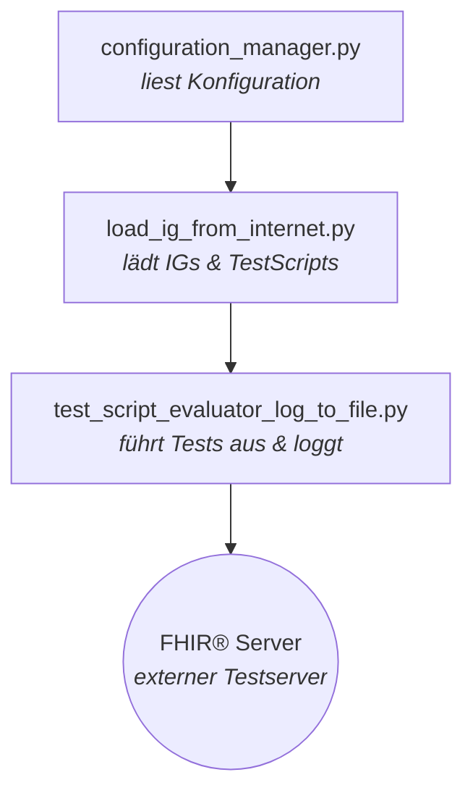
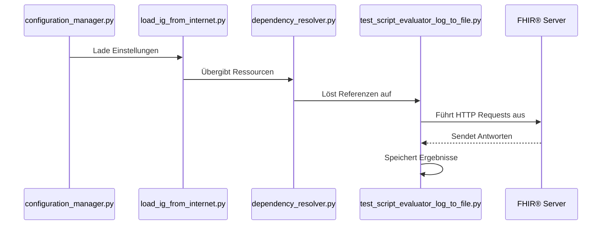

# TestFhiry TestRunner

Das Tool lädt automatisch zuvor definierte **TestScripts** herunter, führt sie gegen einen **FHIR®-Server** aus und dokumentiert die Ergebnisse.
Dadurch können Entwickler:innen frühzeitig Fehler erkennen und die **Konformität mit dem FHIR®-Standard** sicherstellen.

Dies ist ein Teil eines übergestellten Studienprojekts, der zweite Teil ist das Projekt [TestFhiry-TinkerTool](https://github.com/HL7Austria/HL7-AT-TestFhiry-TinkerTool)

---
## Inhaltsverzeichnis

- [TestFhiry TestRunner](#testfhiry-testrunner)
  - [Inhaltsverzeichnis](#inhaltsverzeichnis)
  - [Einleitung](#einleitung)
    - [Zielsetzung](#zielsetzung)
    - [Aktuelle Funktionalität](#aktuelle-funktionalität)
      - [Speicherung der TestScripts](#speicherung-der-testscripts)
      - [Ergebnisspeicherung (Laufzeit)](#ergebnisspeicherung-laufzeit)
  - [Systemüberblick und Architektur](#systemüberblick-und-architektur)
    - [Aufbau](#aufbau)
    - [Verzeichnis-Zweck](#verzeichnis-zweck)
    - [Ablaufdiagramm](#ablaufdiagramm)
  - [Funktionsweise](#funktionsweise)
  - [Installation \& Setup](#installation--setup)
    - [Voraussetzungen](#voraussetzungen)
    - [Installation](#installation)
    - [Ausführung](#ausführung)
  - [Codebase Overview](#codebase-overview)
    - [exception/](#exception)
    - [ig\_loader/](#ig_loader)
    - [model/](#model)
    - [test\_script\_evaluator/](#test_script_evaluator)
    - [transactions/](#transactions)
  - [Autocreate Reference Resolution](#autocreate-reference-resolution)
  - [Bibliotheken](#bibliotheken)
  - [Projektteam](#projektteam)
  - [TestScript-Mapping](#testscript-mapping)

---
## Einleitung
### Zielsetzung
Der TestRunner soll eine **einheitliche, automatisierte Testumgebung** für FHIR®-Ressourcen bieten.
Konkret ermöglicht er:

* Automatisiertes Testen von FHIR®-Ressourcen
* Analyse und Export der Testergebnisse
* Frühzeitiges Erkennen von Fehlerquellen
* Wiederholbare und nachvollziehbare Testabläufe

### Aktuelle Funktionalität

- Fixtures werden automatisch erstellt
- Setup-/ Test-/ Teardown-Action führt die definierte Operation aus
- Setup-/ Test-Assert validiert das Zielobjekt der Assertion
- Optionaler Testabbruch bei fehlgeschlagener Assertion
- Validierung anhand einer definierten Profil-ID
- Fixtures werden automatisch gelöscht

#### Speicherung der TestScripts

Alle **FHIR® TestScripts** aus den Leitfäden werden zentral gespeichert und können über `load_ig_from_internet.py` automatisiert heruntergeladen werden.

* **Speicherort**: Die Scripts werden als **JSON-Dateien** im konfigurierten `path`-Verzeichnis unter `Test_Scripts/` abgelegt.

#### Ergebnisspeicherung (Laufzeit)

> **Skip-Verhalten:** Laut FHIR R4-Spezifikation wird ein TestScript (oder einzelne Tests) geskippt, wenn die `metadata.capability`-Prüfung fehlschlägt – d.h. der Server erfüllt die im TestScript geforderten Capabilities nicht. **Dieser Mechanismus ist noch nicht implementiert.** Aktuell tritt `result="skip"` nur auf, wenn kein FHIR-Server konfiguriert ist.

Während der Ausführung sammelt der `ResultTracker` (`result_tracker.py`) alle Testergebnisse zentral im Arbeitsspeicher und persistiert sie am Ende des Programmlaufs.

**Wo wird gespeichert?**

* **JUnit-Datei**: Am Ende jedes Programmlaufs wird eine JUnit-style XML-Datei `test_results_<Zeitstempel>.xml` im `Junit/`-Ordner abgelegt (Standard: `<path>/Result/Junit/`, konfigurierbar über `results_path`).
* **Log-Datei und Kommunikations-Logs**: siehe [Logging](#logging).

**Was wird gespeichert?**

Pro TestScript-Ausführung wird ein Ergebnisobjekt mit folgenden Feldern angelegt:

| Feld | Beschreibung |
|------|--------------|
| `name` | Name oder ID des TestScripts |
| `url` | Kanonische URL des TestScripts (`TestScript.url`, `1..1` laut FHIR R4) |
| `outcome` | Gesamtergebnis: `pass`, `fail`, `error` oder `skip` (Vorrang: `error` > `fail` > `skip` > `pass`) |
| `outcomes` | Liste der Phasen-Ergebnisse (siehe unten) |

Jede Phase (Setup, jeder einzelne Test, Teardown) erzeugt ein eigenes Phasen-Ergebnisobjekt:

| Feld | Beschreibung |
|------|--------------|
| `class` | Phasentyp: `Setup`, `Test` oder `Teardown` |
| `name` | Name der Phase (Testname bzw. `"Setup"`/`"Teardown"`) |
| `time_spent` | Laufzeit der Phase in Sekunden |
| `assertion_count` | Anzahl der deklarierten Assertions in der Phase |
| `result` | Phasenergebnis: `pass`, `fail`, `error` oder `skip` (siehe unten) |
| `message` | Fehler- oder Erfolgsmeldung der Phase |
| `error_type` | Ursprüngliche Fehlerklasse (z.B. `AssertionError`, `ConnectionError`, `NotImplementedError`) |

**Bedeutung der Ergebnisse** (in der JUnit-Datei als `<failure>` bzw. `<error>`):

| Ergebnis | Bedeutung | Wer muss handeln? |
|----------|-----------|-------------------|
| `fail` | Eine Assertion ist fehlgeschlagen – der FHIR-Server verhält sich nicht wie erwartet. | Server-Entwickler:innen |
| `error` | Der Test konnte nicht ausgeführt werden – z.B. ungültiges TestScript, nicht unterstütztes Feature, Server nicht erreichbar, Validator-Problem oder Fixture konnte nicht angelegt werden. | TestScript-Autor:innen bzw. Betrieb des TestRunners |
| `skip` | Der Test wurde nicht ausgeführt, weil das TestScript vorher abgebrochen wurde oder kein FHIR-Server konfiguriert ist. | – |

**Nicht ladbare TestScripts und Konfigurationsfehler** gehen nicht verloren, sondern erscheinen ebenfalls als `error` im Bericht:

* Kann ein TestScript nicht geladen werden (Datei fehlt, ungültiges JSON, Example Instance zu einer Fixture nicht gefunden), wird es mit dem Dateinamen und der Phase `Load` als `error` eingetragen. Die übrigen TestScripts laufen weiter.
* Ist `path` leer oder kein existierendes Verzeichnis, oder werden keine TestScripts gefunden, wird ein Eintrag `Configuration` als `error` angelegt und das Programm mit Exit-Code `1` beendet.

---

## Systemüberblick und Architektur

### Aufbau

```
.
├─ impl/
│  ├─ exception/               # Benutzerdefinierte Exceptions
│  ├─ ig_loader/               # Lädt IGs, Example Instances und Profile aus dem Internet
│  ├─ model/                   # Modelle für config.json und Fixtures
│  ├─ test_script_evaluator/   # Dateien zur Evaluierung der Test-Scripts
│  ├─ config.json              # Konfiguration für die Ausführung
│  └─ __main__.py              # Einstiegspunkt der Anwendung
├─ requirements.txt            # Python-Abhängigkeiten
│
│  # Folgende Ordner werden im konfigurierten 'path'-Verzeichnis erstellt:
│  <path>/
│  ├─ Example_Instances/       # Wird automatisch erstellt und enthält Example Instances
│  ├─ Profiles/                # Wird automatisch erstellt und enthält Profile
│  ├─ Test_Scripts/            # Wird automatisch erstellt und enthält Test-Scripts
│  └─ Result/                  # Wird automatisch erstellt (oder <results_path>/)
│     ├─ Junit/                 # JUnit-XML pro Lauf
│     ├─ Txt-files/             # Zusammenfassung pro Lauf
│     ├─ Logs/                  # Log-Datei pro Lauf
│     └─ communication_logs/    # Requests/Responses pro Lauf

```
### Verzeichnis-Zweck
**Example_Instances/:** Wird im `path`-Verzeichnis automatisch erstellt. Enthält alle heruntergeladenen Example Instances.


**Profiles/:** Wird im `path`-Verzeichnis automatisch erstellt. Enthält alle geladenen Profile.


**Test_Scripts/:** Wird im `path`-Verzeichnis automatisch erstellt. Enthält alle Test-Skripte.


**Result/:** Wird automatisch erstellt. Standardmäßig im `path`-Verzeichnis, oder im `results_path`-Verzeichnis falls konfiguriert. Enthält die Ergebnisse, Log-Dateien und Kommunikations-Logs der Ausführungen (siehe [Logging](#logging)).


**exception/:** Enthält alle benutzerdefinierten Exceptions.


**ig_loader/:** Enthält das Skript `load_ig_from_internet.py`, das optional ausgeführt werden kann, um die benötigten Ordner zu erstellen und Dateien aus dem Internet zu laden (nur nötig wenn die Ordner noch nicht vorhanden sind).


**model/:** Enthält alle Datenmodelle, z. B. für die Konfiguration, Fixtures, Interaktionen und Variablen.


**test_script_evaluator/:** Enthält alle Dateien, die für die Evaluierung der Test-Scripts benötigt werden.


**transactions/:** Enthält Dateien, die für die Erstellung von FHIR® Transaction Bundles benötigt werden.


### Ablaufdiagramm


---

## Funktionsweise

1. Konfiguration aus `config.json` wird geladen.
2. Das Tool lädt Implementation Guides (TestScripts & Example Instances).
3. Alle Referenzen der autocreate Fixtures werden aufgelöst.
4. Tests werden ausgeführt (POST, GET, PUT).
5. Ergebnisse werden als JUnit-Datei exportiert.


---

## Installation & Setup

### Voraussetzungen

* **Python >= 3.10**
* Internetverbindung (für `load_ig_from_internet.py`)
* Zugriff auf einen **FHIR®-kompatiblen Server**
* **Java Runtime** (für `validator_cli.jar`, falls Validierung verwendet wird)
* **Internetverbindung für Validator** (falls Validierung verwendet wird): Der `validator_cli.jar` lädt bei der ersten Ausführung automatisch die benötigten FHIR-Pakete (z.B. `hl7.fhir.r4.core`) aus dem Internet in den lokalen Package Cache. Ohne Internetverbindung schlägt die Validierung fehl, wenn die Pakete noch nicht lokal vorhanden sind.

### Installation

```bash
git clone https://github.com/HL7Austria/HL7-AT-TestFhiry-TestRunner.git
cd HL7-AT-TestFhiry-TestRunner
pip install -r requirements.txt
```

### Konfiguration (`config.json`)

Vor der Ausführung muss eine `config.json` erstellt werden. Beispiel:

```json
{
  "url": "<url_zum_IG>",
  "path": "C:/Pfad/zum/Überordner",
  "testscripts": [
    "Test_Scripts/TestScript-beispiel.json"
  ],
  "fhirServer": "<fhirServer>",
  "results_path": "",
  "validation": {
    "fhirVersion": "4.0"
  },
  "logging": {
    "consoleLevel": "INFO",
    "fileLevel": "DEBUG",
    "communicationLogs": true,
    "includeCommunicationInLog": false
  }
}
```

| Feld            | Pflicht | Beschreibung                                                                                                                                                  |
| --------------- | ------- | ------------------------------------------------------------------------------------------------------------------------------------------------------------- |
| `url`           | Ja      | URL des Implementation Guide, aus dem TestScripts und Example Instances heruntergeladen werden.                                                               |
| `path`          | Ja      | Pfad zum **Überordner**, der die Unterordner `Profiles/`, `Example_Instances/`, `Test_Scripts/` und die `validator_cli.jar` enthält (bzw. in dem sie erstellt werden). |
| `testscripts`   | Nein    | Liste von TestScript-Pfaden (relativ zu `path`). Wenn leer, werden alle `.json`-Dateien aus `Test_Scripts/` verwendet.                                        |
| `fhirServer`    | Ja      | URL des FHIR®-Servers, gegen den die Tests ausgeführt werden.                                                                                                 |
| `results_path`  | Nein    | Pfad, in dem die Unterordner `Junit/`, `Txt-files/`, `Logs/` und `communication_logs/` erstellt werden. Wenn leer, wird `Result/` im `path`-Verzeichnis verwendet.                                                  |
| `validation`    | Nein    | Einstellungen für den HL7 Validator CLI. `validation.fhirVersion` legt die FHIR®-Version fest, gegen die validiert wird (z. B. `"4.0"` oder `"5.0"`). Standard: `"4.0"`. |
| `logging`       | Nein    | Einstellungen für Konsole, Log-Datei und Kommunikations-Logs, siehe [Logging](#logging). |

> **Wichtig:** Der Wert von `path` muss auf den **Überordner** zeigen, der folgende Struktur enthält (oder in dem sie angelegt wird):
> ```
> <path>/
> ├── Profiles/
> ├── Example_Instances/
> ├── Test_Scripts/
> └── validator_cli.jar
> ```

> **Results-Ordner:** Die JUnit-XML-Dateien werden in einem Unterordner `Junit/` gespeichert. Wenn `results_path` gesetzt ist, werden sie unter `<results_path>/Junit/` abgelegt. Wenn `results_path` nicht gesetzt ist, werden sie unter `<path>/Result/Junit/` erstellt.

### Ressourcen herunterladen (optional)

Falls die Ordner `Profiles/`, `Example_Instances/` und `Test_Scripts/` noch nicht existieren oder leer sind, können die Ressourcen automatisch aus dem Internet heruntergeladen werden:

```bash
python -m impl.ig_loader.load_ig_from_internet --config Pfad/zur/config.json
```

> **Hinweis:** Dieser Schritt ist nur nötig, wenn die Ordner mit Profiles, Example Instances und Test Scripts noch nicht vorhanden sind. Wenn diese bereits befüllt sind, kann dieser Schritt übersprungen werden.

### Ausführung

Das Argument `--config` ist **pflicht** und muss den Pfad zur `config.json` angeben:

```bash
python -m impl --config Pfad/zur/config.json
```

Beispiel:

```bash
python -m impl --config impl/config.json
```

Das Argument `--novalidator` ist optional und wird verwendet um die ausführung des `validator_cli.jar` zu stoppen.

Beispiel:

```bash
python -m impl --config impl/config.json --novalidator
```

### Logging

Jeder Lauf schreibt sein Log gleichzeitig auf die **Konsole** und in eine **Log-Datei**. Zu Beginn werden die Konfiguration und die Umgebung protokolliert (Config-Datei, FHIR®-Server, Ergebnis-Ordner, Validator-JAR und Java-Version, Logging-Einstellungen, auszuführende TestScripts) und vor Einstellungen gewarnt, die den Lauf scheitern lassen (z. B. fehlender FHIR®-Server oder fehlende `validator_cli.jar`). Danach folgen pro TestScript die Phasen, Fixtures, Operationen, Assertions und deren Ergebnisse.

```
<results>/
├─ Logs/test_run_<Zeitstempel>.log
└─ communication_logs/test_run_<Zeitstempel>/
   ├─ 01_TestScript-testscript-patient-create-at-core/
   │  └─ REQ-0001_POST_Patient/
   │     ├─ request.http     # Request-Zeile, Header und Body wie gesendet
   │     └─ response.http    # Status-Zeile, Header und Body wie empfangen
   └─ 02_TestScript-testscript-patient-update-at-core/
      ├─ REQ-0002_PUT_Patient_HL7ATCorePatientUpdateTestExample/
      └─ ...
```

Log-Datei, JUnit-XML und Zusammenfassung eines Laufs tragen denselben Zeitstempel.

**Kommunikations-Logs:** Jeder Request an den FHIR®-Server bekommt eine laufweit eindeutige **Request-ID** (`REQ-0001`, `REQ-0002`, …). Request und Response werden ungefiltert in einem eigenen Ordner abgelegt; der Ordnername beginnt mit der Request-ID. Kam keine Response zurück (z. B. Server nicht erreichbar), liegt statt `response.http` eine `error.txt` im Ordner. Komprimierte Response-Bodies werden entpackt gespeichert.

Im Log verweist jede Zeile, die einen Request betrifft, auf die Request-ID und den Ordner relativ zum `communication_logs/test_run_<Zeitstempel>/`-Ordner. Auch Assertions nennen die Request-ID der Response, gegen die sie geprüft wurden:

```
11:20:14 INFO    Operation create Patient (POST, sourceId patient-create, responseId create-response)
11:20:14 INFO    REQ-0001 POST http://localhost:8080/fhir/Patient -> 201 Created (20 ms) [01_TestScript-testscript-patient-create-at-core/REQ-0001_POST_Patient]
11:20:14 INFO    Assert passed: responseCode in '200,201' [REQ-0001]
11:22:29 ERROR   Assert failed (stopTestOnFail): contentType 'xml' [REQ-0028] - Expected 'application/fhir+json;charset=UTF-8' to contain 'xml'
```

**Einstellungen** (Objekt `logging` in der `config.json`, alle optional):

| Feld                        | Standard | Beschreibung |
| --------------------------- | -------- | ------------ |
| `consoleLevel`              | `INFO`   | Level der Konsolen-Ausgabe (`DEBUG`, `INFO`, `WARNING`, `ERROR`, `CRITICAL`). |
| `fileLevel`                 | `DEBUG`  | Level der Log-Datei. Auf `DEBUG` enthält sie zusätzlich Beschreibungen der Actions, Variablenwerte, Fixture-Details, Validator-Aufrufe samt Ausgabe und Tracebacks. |
| `communicationLogs`         | `true`   | Requests und Responses im Ordner `communication_logs/` ablegen. Die Request-IDs stehen auch bei `false` im Log. |
| `includeCommunicationInLog` | `false`  | Requests und Responses zusätzlich vollständig ins Log schreiben (als `DEBUG`-Einträge, also nur wenn `consoleLevel` oder `fileLevel` auf `DEBUG` steht). |

---

## Codebase Overview

### exception/

**Hauptdateien:**
- `Error.py` → Benutzerdefinierte Exceptions (`TestExecutionError`, `TestScriptError`, `OperationError`, `CircularDependencyError`, `UnresolvedReferenceError`, `ReferenceResolutionError`). 

### ig_loader/

**Hauptdateien:**
- `load_ig_from_internet.py` → Lädt Example Instances, Profile und Test-Skripte aus dem Internet und speichert sie in den vorgesehenen Ordnern. 


### model/

**Hauptdateien:**
- `configuration.py` → Modell für das config.json-File. 
- `fixture.py` → Modell für die Fixtures. 
- `interaction.py` → Modell für HTTP-Interaktionen (Request/Response). 
- `variable.py` → Modell für TestScript-Variablen. 

### test_script_evaluator/

**Hauptdateien:**
- `configuration_manager.py` → Lädt und verwaltet Konfigurationseinstellungen. 
- `log_setup.py` → Richtet Konsolen- und Datei-Log ein und protokolliert Konfiguration und Umgebung.
- `communication_logger.py` → Sendet die Requests an den FHIR®-Server, vergibt Request-IDs und schreibt die Kommunikations-Logs.
- `dependency_resolver.py` → Bestimmt Erstellungsreihenfolge und löst Referenzen auf.
- `reference_parser.py` → Durchsucht Fhir-Ressourcen auf Referenzen.
- `test_script_evaluator_log_to_file.py` → Hauptskript für die Evaluierung von Test-Scripts. 
- `utils.py` → Hilfsfunktionen, die mehrfach verwendet werden. 
- `validate.py` → Validierungen der Test-Scripts. 

#### Namespace-Handling in **eval_xpath**

Die Methode **eval_xpath** entfernt vor der XPath-Auswertung alle XML-Namespaces aus dem geparsten Dokument.
Dazu wird über alle Elemente iteriert und jeder Tag sowie jedes Attribut auf seinen lokalen Namen reduziert (`etree.QName(...).localname`).
Anschließend werden nicht mehr referenzierte Namespace-Deklarationen mittels `etree.cleanup_namespaces()` bereinigt.

Dies ist notwendig, weil FHIR®-XPath-Ausdrücke in TestScripts typischerweise ohne Namespace-Präfixe formuliert sind (z. B. `Patient/name/family` statt `fhir:Patient/fhir:name/fhir:family`).
Ohne diese Bereinigung würden solche Ausdrücke gegen ein namespace-behaftetes XML-Dokument keine Treffer liefern.
Das bedeutet auch, dass XPath-Ausdrücke in den TestScripts **ohne Namespace-Präfixe** (z. B. `fhir:`) geschrieben sein müssen, damit sie korrekt ausgewertet werden.

#### Encoding-Workaround in **eval_xpath**

Vor dem Parsen wird die XML-Deklaration (`<?xml ... ?>`) per Regex entfernt und der String anschließend als UTF-8 kodiert.
`lxml.etree.fromstring()` akzeptiert bei einem `bytes`-Objekt die Encoding-Angabe aus der Deklaration, wirft aber einen Fehler wenn ein Python-`str` (der intern bereits Unicode ist) eine Encoding-Deklaration enthält.
Da kein zuverlässigerer Weg gefunden wurde, diesen Konflikt aufzulösen, wird die Deklaration schlicht entfernt bevor der Body als `bytes` an den Parser übergeben wird.

---

## Autocreate Reference Resolution

Das Tool verfügt über ein automatisches Reference Resolution System für Fixtures mit `autocreate=true`. Dieses System stellt sicher, dass Fixtures in der korrekten Reihenfolge erstellt werden, damit Referenzen zwischen Fixtures korrekt aufgelöst werden können.

#### Funktionsweise

1. **Referenz-Parsing**: Alle Fixtures werden nach Referenzen auf andere Fixtures gescannt (sowohl JSON als auch XML)
2. **Dependency Resolution**: Die Fixtures werden topologisch sortiert, um die korrekte Erstellungsreihenfolge zu bestimmen
3. **Sequentielle Erstellung**: Fixtures werden nacheinander erstellt, beginnend mit denen ohne Abhängigkeiten
4. **Referenz-Ersetzung**: Während der Erstellung werden lokale Fixture-Referenzen durch die tatsächlichen Server-IDs ersetzt

#### Vorteile

- Keine zirkulären Abhängigkeiten werden toleriert (werden mit Fehler abgebrochen)
- Referenzen werden automatisch mit server-seitigen IDs aktualisiert
- Keine manuelle Anpassung von Referenzen erforderlich

#### Voraussetzungen für TestScripts

Damit das Autocreate Reference Resolution System korrekt funktioniert, müssen TestScripts folgende Anforderungen erfüllen:

**WICHTIG**: Wenn ein Fixture mit `autocreate=true` auf eine Referenz verweist, muss diese Referenz ebenfalls als Fixture im TestScript definiert sein und `autocreate=true` haben.

**Beispiel:**
```json
{
  "fixture": [
    {
      "id": "patient-a",
      "autocreate": true,
      "resource": {
        "reference": "Patient/PatientExample"
      }
    },
    {
      "id": "patient-b",
      "autocreate": true,
      "resource": {
        "reference": "Patient/PatientWithReference"
      }
    }
  ]
}
```

Wenn `PatientWithReference` auf `PatientExample` verweist, muss `PatientExample` ebenfalls als Fixture mit `autocreate=true` definiert sein. Andernfalls schlägt die Erstellung fehl.

**Referenztypen:**
- `reference` Felder
- `contained` Ressourcen
- Verschachtelte Referenzen in beliebigen Pfaden (z.B. `Patient.link.other`)

**Fixtures in XML und JSON**
Die Verbindung zwischen einer Fixture-Referenz im TestScript und der entsprechenden Datei erfolgt über den **Basisnamen** (Dateiname ohne Extension).

**Beispiel:**
```json
{
  "fixture": [
    {
      "id": "patient-a",
      "resource": {
        "reference": "Patient-HL7ATCorePatientExample.html"
      }
    }
  ]
}
```

Das Tool sucht nach einer Datei mit dem Basisnamen `Patient-HL7ATCorePatientExample` im `Example_Instances/` Ordner

Wenn eine Fixture sowohl als XML- als auch als JSON-Datei existiert, müssen sie unterschiedliche Basisnamen haben, damit klar ist, welche verwendet wird. Die richtige Benutzung und Referenzierung innerhalb des TestScripts ist somit alleinige Verantwortung des Benutzers.

**Gleichnamige SourceIds**
Wenn zwei interne Ids (responseId, fixtureId) gleich benannt sind, wird der Ablauf des Programms gestoppt und das TestScript wird geskippt.

**Referenzen in Example Instances**
Die Referenzen innerhalb der Example Instances (z.B. in `link`-Feldern oder anderen `reference`-Feldern) funktionieren mit den IDs der Example Instances. 

**WICHTIG**: Damit das Autocreate Reference Resolution System korrekt erkennen kann, auf welche Fixture verwiesen wird, müssen die IDs innerhalb der heruntergeladenen Example Instances unterschiedlich sein. Jede Example Instance sollte eine eindeutige ID haben, um Konflikte bei der Dependency-Resolution zu vermeiden.

**Beispiel:**
- `Patient-HL7ATCorePatientExample01.json` hat `id: "HL7ATCorePatientExample01"`
- `Patient-HL7ATCorePatientExample02.json` hat `id: "HL7ATCorePatientExample02"`

Wenn zwei Example Instances die gleiche ID haben, kann das System nicht unterscheiden, auf welche verwiesen wird, was zu Fehlern bei der Dependency-Resolution führen kann.

---

## Bibliotheken

| Bibliothek              | Zweck                                        |
| ----------------------- | -------------------------------------------- |
| `requests`              | Kommunikation mit FHIR®-Server               |
| `beautifulsoup4`        | Parsing von Webseiteninhalten                |
| `fhirpathpy`            | Auswertung von FHIRPath-Ausdrücken           |
| `jsonpath_ng`           | Auswertung von JSONPath-Ausdrücken           |
| `lxml`                  | XML-Parsing und Validierung                  |
| `fhir.resources`, `xmltodict`| XML - Dictionary Übersetzung für fhirpath|
| `json`, `os`, `pathlib` | Dateiverwaltung und Strukturierung (stdlib)  |

Alle Abhängigkeiten sind in der `requirements.txt` definiert:

```
requests~=2.32.3
beautifulsoup4~=4.14.2
fhirpathpy~=0.2.2
jsonpath_ng~=1.7.0
lxml~=5.4.0
fhir.resources~=8.2.0
xmltodict~=0.13.0
junitparser~=5.0.1
```

---

## Projektteam

* Julia Bodingbauer  
* Delaram Darehshoori  
* Magdalena Dorr  
* Alina Haider  
* Michael Bogensberger  
* Laura Ziebermayr

---
## TestScript-Mapping

Die folgende Tabelle zeigt, welche Felder aus der FHIR®-TestScript-Ressource im PythonTool noch nicht umgesetzt wurden:

| Abschnitt       | Feld              | Beschreibung                        | Priorität | Implementiert |
| --------------- | ----------------- | ----------------------------------- | --------- | ------------- |
| metadata    | Capability       | Programm-Abbruch bei Fehlschlag      | –         | –             |
| Test–Operation    | destination       | Request-Ziel         | –         | –             |
| Test–Operation    | origin       | Request-Herkunft          | –         | –             |
| Test–Operation    | requestId       | ID für das Speichern des Requests          | –         | out of scope            |
| Test–Assert    | defaultManualCompletion       | Pausieren des Programms         | –         | out of scope            |
| Test–Assert    | minimumId       | Vergleichsresource         | –         | –             |
| Test–Assert    | navigationLinks       | Validierung der Navigation-Links in einem Bundle          | –         | –             |
| Test–Assert    | requestMethod       | Methode des zu empfangenden Requests         | –         | out of scope             |
| Test–Assert    | requestURL       | URL des Requests          | –         | out of scope             |
| Test–Assert    | response       | Response-Bezeichnung (okay, accepted usw.)          | –         | partiell             |
| Test–Assert    | warningOnly       | Nur Warnung bei Fehlschlag          | –         | ✅             |
| Test–Assert    | stopTestOnFail       | Abbruch des aktuellen Tests bei Fehlschlag (siehe unten)          | –         | ✅             |

> **Hinweis zu `stopTestOnFail`:** Die R5-Spezifikation widerspricht sich bei diesem Element. Kurzbeschreibung und Definition („If this assert fails, will the current test execution stop?“) besagen, dass `true` den aktuellen Test abbricht. Der Kommentar besagt das Gegenteil, ist aber eine Kopie des `warningOnly`-Kommentars und wird als Fehler in der Spezifikation behandelt. Der TestRunner verhält sich daher so:
>
> * `true`: Der aktuelle Test wird abgebrochen. Die übrigen Tests und das Teardown laufen weiter.
> * `false` oder nicht angegeben (R4 kennt das Element nicht): Der Fehlschlag wird protokolliert, der Test läuft mit den restlichen Actions weiter.
> * `warningOnly` hat Vorrang: Ist es `true`, wird nur eine Warnung ausgegeben.


---
